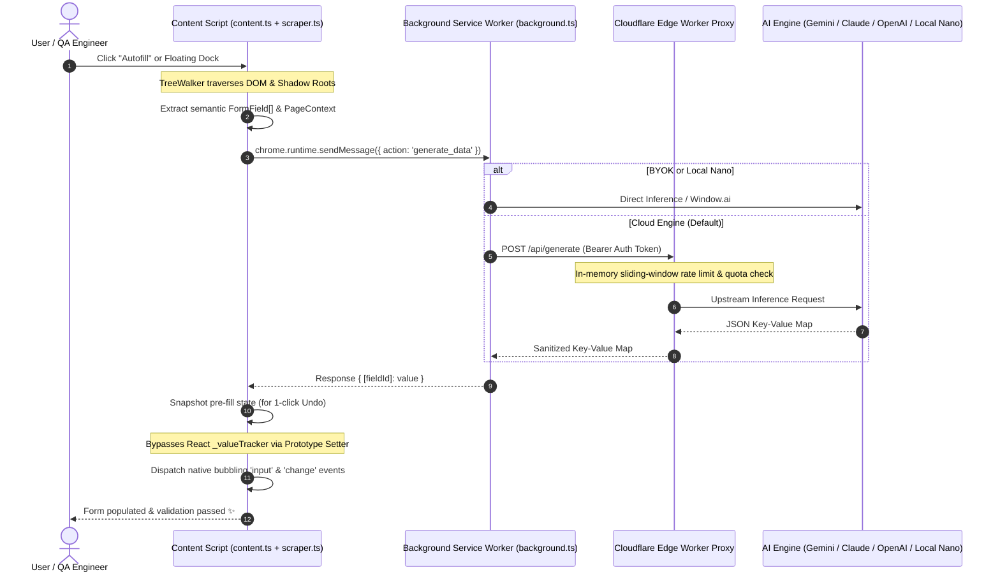

<p align="center">
  <a href="https://chromewebstore.google.com/detail/filli-ai-ai-form-filler-q/hgegjecojocbaajhpphckaphclpdkbhl">
    
  </a>
</p>

<h1 align="center">Filli AI</h1>

<p align="center">
  <strong>Context-Aware AI Form Filler & SDET QA Test Data Generator</strong><br>
  Built for modern web applications, complex multi-step checkouts, and enterprise SPAs.
</p>

<p align="center">
  <a href="https://chromewebstore.google.com/detail/filli-ai-ai-form-filler-q/hgegjecojocbaajhpphckaphclpdkbhl">
    
  </a>
  <a href="LICENSE">
    
  </a>
  
  
  
</p>

<p align="center">
  <a href="https://chromewebstore.google.com/detail/filli-ai-ai-form-filler-q/hgegjecojocbaajhpphckaphclpdkbhl"><b>⚡ Add to Chrome (Free)</b></a> •
  <a href="#-system-architecture"><b>Architecture</b></a> •
  <a href="#-under-the-hood-engineering-challenges"><b>Under the Hood</b></a> •
  <a href="#-getting-started"><b>Local Dev</b></a>
</p>

<p align="center">
  
</p>

---

## ⚡ What is Filli AI?

Filling out web forms manually during software testing, QA audits, or daily work is slow and repetitive. Traditional autofill extensions rely on static dummy dictionaries (e.g., `Lorem Ipsum` or hardcoded emails) that fail modern validation rules, fail to trigger framework change detectors, and break on dynamic forms.

**Filli AI** is an intelligent browser extension (Manifest V3) that inspects the page DOM, traverses Shadow DOM boundaries, analyzes form semantics, and synthesizes context-aware mock data or security test payloads on the fly.

- **For End Users:** 1-click intelligent autofill that understands the purpose of each field (shipping addresses, realistic names, B2B company profiles).
- **For QA & SDET Engineers:** Instant boundary testing, maximum character limit overflows, regex fuzzing, and OWASP penetration test suites (XSS/SQLi) with 1-click Markdown export to Jira and GitHub.

---

## 🌟 Key Features

| Feature | Description |
| :--- | :--- |
| **🧠 Context-Aware Synthesis** | Extracts semantic clues (`labels`, `placeholders`, `aria-tags`, surrounding headings) to generate contextually accurate inputs. |
| **🧪 QA & SDET Pentest Suite** | Generates boundary test cases, integer overflow limits, unicode stress tests, and OWASP payloads. |
| **⚛️ Framework Interoperability** | Seamlessly triggers change events in React, Vue, Angular, and Svelte forms without wiping input values. |
| **🥷 Shadow DOM Traversal** | Recursively pierces encapsulated `shadowRoot` elements in enterprise Web Components and micro-frontends. |
| **🛡️ Privacy & BYOK** | Supports Cloudflare Edge Proxy with Gemini Pro, local on-device inference via **Chrome Gemini Nano**, or personal API keys (OpenAI / Anthropic / Gemini). |
| **⏪ 1-Click Undo Snapshots** | Takes an in-memory snapshot of DOM form state prior to injection, allowing 1-click reversal anytime. |

---

## 🏗️ System Architecture

Filli AI is architected under strict **Chrome Manifest V3** constraints, separating DOM operations, ephemeral lifecycle orchestration, and edge security.



---

## 🔬 Under the Hood: Engineering Challenges

### 1. Bypassing React and Vue Synthetic Event Interception
Standard DOM assignments like `input.value = "Jane"` fail on React, Vue, and modern SPAs. React attaches an internal tracker (`_valueTracker`) to inputs; setting `.value` directly does not notify React's Virtual DOM, causing values to vanish immediately upon form submission or next re-render.

**Solution (`src/content/scraper.ts`):**
Filli AI fetches the unpolluted prototype property descriptor directly from the browser window and invokes it within the target element context:

```typescript
// Bypass React/Vue input value tracker
const prototype = isInput 
  ? window.HTMLInputElement.prototype 
  : window.HTMLTextAreaElement.prototype;

const nativeValueSetter = Object.getOwnPropertyDescriptor(prototype, 'value')?.set;

if (nativeValueSetter) {
  nativeValueSetter.call(input, value);
} else {
  input.value = value;
}

// Dispatch synthetic bubbling events to trigger state synchronization
input.dispatchEvent(new Event('input', { bubbles: true }));
input.dispatchEvent(new Event('change', { bubbles: true }));
```

---

### 2. Piercing Encapsulated Shadow DOM Boundaries
Modern micro-frontends and design systems (e.g., Salesforce Lightning, Shopify Admin, Web Components) encapsulate inputs inside Shadow DOMs, making traditional `document.querySelectorAll()` blind to active form fields.

**Solution (`src/content/scraper.ts`):**
We utilize a recursive `TreeWalker` (`document.createTreeWalker`) that actively checks for `node.shadowRoot`. It crawls across shadow boundaries, parses field constraints (`pattern`, `maxLength`, `required`), and serializes them into a token-efficient JSON format for the model.

---

### 3. Ephemeral MV3 Service Workers & Edge Rate Limiting
Under Chrome Manifest V3, background service workers terminate after short periods of inactivity. Storing session state in memory leads to silent data loss.

* **Client State Persistence:** All user settings, profile cards, and usage counters are synced via `chrome.storage.local` with change listeners.
* **Edge Rate Limiting:** To prevent Cloudflare Workers KV write limit exhaustion on high-frequency requests, the proxy implements an **in-memory sliding-window rate limiter** backed by KV reads, reducing write amplification by over 90%.

---

## 📂 Repository Structure

```text
├── manifest.json            # Manifest V3 extension configuration
├── src/
│   ├── background/          # Ephemeral MV3 background service worker
│   │   └── background.ts    # AI routing, context menus & tab message bus
│   ├── content/             # In-page scripts running in host page context
│   │   ├── content.ts       # Floating dock UI & form injection controller
│   │   └── scraper.ts       # TreeWalker DOM parser & React event bypass
│   ├── popup/               # Browser action popup UI (React + Tailwind)
│   ├── options/             # Extension options & profile manager
│   ├── proxy/               # Cloudflare Workers edge backend proxy
│   │   ├── auth.js          # Session & token verification
│   │   └── rateLimiter.js   # Sliding-window rate limiting
│   └── lib/                 # QA edge-case generators & report exporters
├── public/                  # Static assets & icons
└── vite.config.ts           # CRX build configuration
```

---

## 🛠️ Getting Started (Local Development)

### Prerequisites
* Node.js 18+
* npm or pnpm

### 1. Clone & Install
```bash
git clone https://github.com/VinayK8866/filli-ai-extension.git
cd filli-ai-extension
npm install
```

### 2. Build Extension
```bash
npm run build
```
This will compile the TypeScript source into the `dist/` directory.

### 3. Load into Google Chrome
1. Open Chrome and navigate to `chrome://extensions/`
2. Enable **Developer mode** in the top-right corner.
3. Click **Load unpacked** and select the `dist/` directory from this repository.
4. Open any web form and use the floating Filli AI dock or right-click context menu!

---

## 🔒 Security & Privacy

* **Zero Data Logging:** Filli AI does not store user form values on remote servers. Form field IDs and labels are analyzed ephemerally for value generation only.
* **OWASP Testing Safety:** The security testing suite generates benign proof-of-concept strings for QA verification only.
* **Bring Your Own Key (BYOK):** Users can supply their own OpenAI, Anthropic, or Gemini API keys stored locally in encrypted browser storage.

---

## 📄 License

This project is licensed under the **Apache License 2.0** - see the [LICENSE](LICENSE) file for details.

---

<p align="center">
  Maintained with precision by <a href="https://github.com/VinayK8866"><strong>Vinay Kondabathula</strong></a>.
</p>
